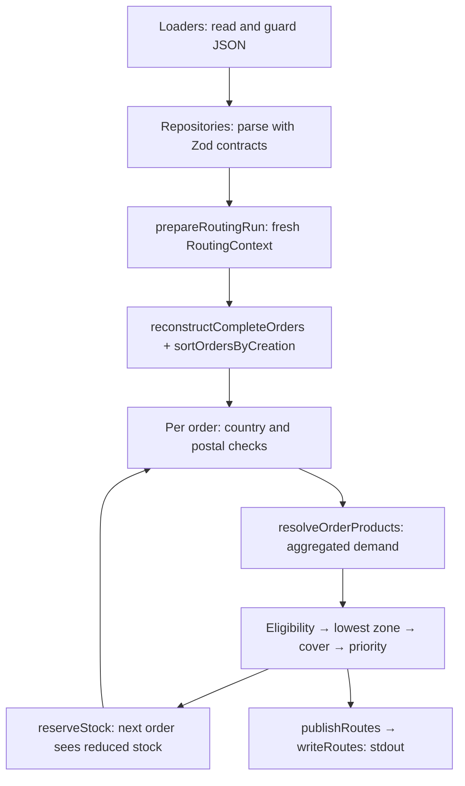

# Architecture

How the order router is structured, which rules hold across the codebase, and where changes belong. Read before placing code, adding a module, or changing how layers depend on each other. Details live in focused guides:

| Guide | Read before |
|---|---|
| [routing.md](routing.md) | Changing order reconstruction, a routing rule, reservation, or output. |
| [input-contracts.md](input-contracts.md) | Relying on or changing what a dataset accepts. |
| [schemas.md](schemas.md) | Writing or composing Zod contracts and normalization. |
| [development.md](development.md) | Running tests, regenerating `routes.txt`, or changing tooling. |

These guides describe the project as it is. Why it is this way is in [DECISIONS.md](../DECISIONS.md), adopted interpretations of unspecified behavior are in [ASSUMPTIONS.md](../ASSUMPTIONS.md), and how it evolved is in [JOURNAL.md](../JOURNAL.md).

## Overview

A command-line program reads four JSON datasets from `data/` (catalog, order events, warehouses, zones), routes every order to one warehouse or PARTNER under the [Part A rules](../INSTRUCTIONS.md#part-a-order-router-about-40-minutes), and prints one tab-separated line per order to stdout. Each run is independent: there is no server, database, or state kept between runs.

TypeScript runs directly on Bun. Zod validates and normalizes input at the boundary; everything after it works with typed, parsed values.

## Layers

Runtime dependencies point one way:

```text
src/router.ts → application → domain → repositories → lib/loader
                                                    → schemas → normalization
```

| Layer | Owns | May import at runtime | Must not |
|---|---|---|---|
| [`src/router.ts`](../src/router.ts) | CLI entry: calls `routeOrders()`, prints errors to stderr, sets exit code 1 | application | Contain paths, rules, or formatting. |
| [`src/application/`](../src/application/route-orders.ts) | `routeOrders()`: the visible sequence of rules 1–7, reservation between orders, publication | domain | Import repositories, loaders, or schemas; accept source arguments. |
| [`src/domain/`](../src/domain/) | `RoutingContext`, order reconstruction, product demand, routing rules, reservation, `RoutingResult` | repositories | Read files, parse with Zod, or format output. |
| [`src/repositories/`](../src/repositories/) | Parameterless `read*` functions that load and parse one dataset; `writeRoutes` that formats and prints results | loader, schemas | Make routing decisions. |
| [`src/lib/loader/`](../src/lib/loader/Loader.ts) | Guarded JSON reading, caching, and dataset paths | Node/Bun file APIs | Validate or normalize. |
| [`src/schemas/`](../src/schemas/) | Zod contracts, inferred input/output types, accepted transformations | normalization, Zod | Perform I/O or cross-file checks. |
| [`src/normalization/`](../src/normalization/) | Pure SKU and ZIP conversion helpers | nothing in the project | Import Zod at runtime, read files, or look up other data. |

Type-only imports may cross layers in either direction: the domain and application use schema output types, and the routes repository uses the domain's `RoutingResult`. Keep them as `import type` so no runtime cycle appears.

## Data flow



Orders are processed one at a time in creation order. Validation and normalization happen once, inside the repositories; the domain never sees raw JSON. Step-by-step rule behavior is in [routing.md](routing.md).

## Ingestion boundary

Each dataset loader in [Loader.ts](../src/lib/loader/Loader.ts) reads its file lazily, shares an in-flight read, caches the parsed value, and retries after a read or parse failure. Every call returns a `structuredClone`, so callers cannot change the cached input. Dataset URLs are relative to the loader module, so the working directory does not matter. Loaders return `unknown` and never call Zod.

Each repository calls its loader and applies its contract with `.parse()` exactly once. JSON goes through the guarded `parseJson`, which rejects `__proto__`, `constructor`, and `prototype` keys. The guard, its [known limitation](schemas.md#known-limitation-direct-schema-calls), and the type conventions are in [schemas.md](schemas.md).

## Core concepts

| Term | Meaning |
|---|---|
| Order event | One parsed record from `orders.json`: `order_created` or `order_edited` (`OrderEventOutput`). Not an order. |
| Order | A complete order rebuilt from its creation plus eligible edits (`Order` in [order.ts](../src/domain/order.ts)). |
| `Sku` | Branded, uppercased product identifier produced by `SkuSchema`. |
| Postal assessment | `recognized` with a prefix, `missing`, or `unrecognized` for US destinations; `null` elsewhere. Computed at ingestion. |
| Product demand | Standalone-product quantities after bundle expansion and aggregation; the only input to eligibility, cover, and reservation. |
| Zone | Shipping zone from 1 to 8 for a warehouse and ZIP prefix; lower is closer. |
| Cover | Minimum `available / dailyVelocity` across the order's products at one warehouse. |
| `RoutingContext` | Parsed events, catalog, zones, and current warehouse inventory for one run. |
| `RoutingResult` | Structured outcome per order: a warehouse with its zone, or PARTNER with a reason. |

## Invariants

1. Never modify `data/`, the loader cache, or parsed input objects. Transformations and reservations return new values.
2. Validate all application input through a guarded loader and a schema in a repository. Consume parsed output; never reparse it through a source schema.
3. Keep source paths and file access below the domain. `routeOrders()` takes no arguments.
4. Keep inventory only in the run's `RoutingContext`. Select using stock before reservation, and reserve before the next order.
5. Feed eligibility, cover, and reservation the same aggregated product demand, never raw order lines.
6. Preserve empty candidate lists through every ranking step; never default to a warehouse.
7. Compare event timestamps with every fractional digit, not with `Date.parse` alone.
8. Decide in the domain and format only in `writeRoutes`; routing results never depend on output text.
9. Let errors propagate. Never turn a load, validation, or unsupported-case failure into empty data or a PARTNER route.
10. Throw for behavior with no adopted policy instead of inventing one; see [unsupported cases](routing.md#unsupported-cases).

## Error handling

Every failure (unreadable file, rejected JSON key, contract violation, unsupported case, or stdout write error) rejects up to `src/router.ts`, which prints the message to stderr and exits with code 1. Results are published only after all orders are routed, so a failure while routing prints no partial output.

## Conventions

- Write small modules of exported plain functions and types. Do not add classes, per-layer interfaces, or dependency injection.
- Name files by concept: `<concept>.schema.ts`, `<dataset>.repository.ts`, `domain/<concept>.ts`.
- Put unit tests next to their module as `*.test.ts`; put tests that cross layers in `tests/` as `*.integration.test.ts` or `*.cli.test.ts`.
- Infer types from schemas with `z.input` and `z.output`; do not hand-write duplicate input types or cast raw values to parsed types. See [schemas.md](schemas.md#separate-source-types-from-parsed-types).
- Comment only context the code cannot show, such as a rule number or a runtime quirk.

## Where changes go

| Change | Where |
|---|---|
| Accept or reject an input value | The schema in `src/schemas/`, plus a pure helper in `src/normalization/` if it converts values. Update [input-contracts.md](input-contracts.md). |
| Change a routing rule | Its named function in `src/domain/`, called from `routeOrders()` in rule order. Recalculate expected outputs by hand first; see [development.md](development.md#expected-outputs-are-independent). Update [routing.md](routing.md). |
| Add a dataset | A loader in `Loader.ts`, a schema, a parameterless `read*` repository, and a field in `RoutingContext` filled by `prepareRoutingRun`. |
| Change output format | `writeRoutes` only, plus the expected fixtures and `routes.txt`. |
| Handle a case the instructions do not specify | Add an open question to [ASSUMPTIONS.md](../ASSUMPTIONS.md#open-questions) and wait for an adopted interpretation before coding it. |

## Project layout

```text
raicom/
├── data/              Working copies of the supplied JSON datasets
├── src/
│   ├── router.ts      CLI entry point
│   ├── application/   Routing coordinator
│   ├── domain/        Reconstruction, demand, rules, reservation
│   ├── repositories/  Dataset reading and route output
│   ├── lib/loader/    Guarded, cached JSON loading
│   ├── schemas/       Zod input contracts
│   └── normalization/ Pure SKU and ZIP helpers
├── tests/             Cross-layer, real-data, and CLI tests
│   └── fixtures/      Synthetic inputs and hand-calculated expected outputs
├── docs/              Guides, data research, and explorations
├── raicom-files/      Original supplied files
├── routes.txt         Submitted output for the supplied data
├── INSTRUCTIONS.md    Assessment brief
├── AGENTS.md          Agent instructions and documentation index
└── ASSUMPTIONS.md, DECISIONS.md, JOURNAL.md   Project records
```

Project-scoped agent skills live in `.agents/skills/`.
