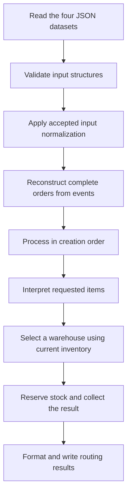

# Project structure and architecture

## Context and current scope

Rafael selected this structure while exploring the application's responsibilities and data flow. The application will use TypeScript 6 and Bun, with pnpm managing dependencies, Zod checking incoming data structures, and Vitest providing the test runner.

The catalog, order-event, warehouse, zone, and reusable SKU contracts are implemented with adjacent unit tests. A raw JSON loader and its tests live in `src/lib/loader/`. Other source and test modules remain empty placeholders. `tests/` contains an empty `.gitkeep` to retain the directory in Git. `routes.txt` is an empty output placeholder, not a generated routing result. The following responsibilities describe the intended application.

ZIP handling, SKU matching, and bundle stock handling remain [open questions](../ASSUMPTIONS.md#open-questions). Structural input validation does not select those policies; normalization and bundle stock expansion remain unimplemented.

Rafael accepted Zod runtime input contracts with inferred TypeScript input types and small reusable sub-contracts. The catalog rules below are implemented with bounded, field-specific acceptance and no automatic conversion. SKU normalization rules and placement remain open.

## Project structure

```text
raicom/
├── data/
│   ├── catalog.json
│   ├── orders.json
│   ├── warehouses.json
│   └── zones.json
├── src/
│   ├── router.ts
│   ├── lib/
│   │   └── loader/
│   │       ├── Loader.ts
│   │       └── Loader.test.ts
│   ├── application/
│   │   └── route-orders.ts
│   ├── domain/
│   │   ├── order.ts
│   │   ├── order.test.ts
│   │   ├── catalog.ts
│   │   ├── catalog.test.ts
│   │   ├── warehouse.ts
│   │   ├── warehouse.test.ts
│   │   ├── routing.ts
│   │   └── routing.test.ts
│   ├── repositories/
│   │   ├── orders.repository.ts
│   │   ├── catalog.repository.ts
│   │   ├── warehouses.repository.ts
│   │   ├── zones.repository.ts
│   │   └── routes.repository.ts
│   ├── schemas/
│   │   ├── order.schema.ts
│   │   ├── order.schema.test.ts
│   │   ├── catalog.schema.ts
│   │   ├── catalog.schema.test.ts
│   │   ├── sku.schema.ts
│   │   ├── sku.schema.test.ts
│   │   ├── warehouse.schema.ts
│   │   ├── warehouse.schema.test.ts
│   │   ├── zones.schema.ts
│   │   └── zones.schema.test.ts
│   └── normalization/
│       ├── zip.ts
│       ├── zip.test.ts
│       ├── sku.ts
│       └── sku.test.ts
├── tests/
│   └── .gitkeep
├── docs/
│   ├── ARCHTECTURE.md
│   └── data-research.md
├── .gitignore
├── AGENTS.md
├── package.json
├── pnpm-lock.yaml
├── tsconfig.json
├── routes.txt
├── JOURNAL.md
├── DECISIONS.md
└── ASSUMPTIONS.md
```

This tree focuses on the application and supporting documents. The supplied originals remain in `raicom-files/`, and project-scoped skills remain in `.agents/skills/`.

## Responsibilities

| Folder or file | Responsibility |
|---|---|
| `data/` | Unmodified working copies of the supplied JSON datasets, ready for ingestion. |
| `src/lib/loader/` | Shared raw JSON reading, guarded parsing, lazy caching, and independent copies for callers. Returns `unknown` without Zod validation or normalization. |
| `src/router.ts` | Executable entry point: establish file locations, invoke the application workflow, and report its outcome. |
| `src/application/route-orders.ts` | Coordinate input loading, complete-order reconstruction, item interpretation, sequential routing with inventory state, and output writing. |
| `src/domain/` | Internal types and business rules for orders, catalog items, warehouses, inventory, and routing results. |
| `src/repositories/` | Input repositories will coordinate the shared loader and schema validation, with normalization placement still open. The routes repository will format and write results. Repository modules remain placeholders. |
| `src/schemas/` | Zod schemas for the shapes and types of incoming data. Runtime checks complement TypeScript's static types. |
| `src/normalization/` | Functions for accepted transformations of input representations. ZIP and SKU policies remain deferred. |
| Adjacent `*.test.ts` files | Focused unit tests for the modules beside them. Input-contract and loader tests are implemented; the earlier domain and normalization test placeholders remain empty. |
| `tests/` | Integration tests covering collaboration between modules and the complete output, once implemented. |
| `routes.txt` | Eventual textual routing output, with one line per order. Currently empty. |

Use small modules and plain functions. The folder boundaries do not require a class, interface, or dependency-injection framework for each responsibility.

## Data flow



The interpretation, selection, and reservation steps run sequentially for each order. Later orders see inventory after earlier reservations. The diagram does not specify the deferred normalization or bundle policies.

Normalization placement in this diagram is illustrative. Rafael left open whether SKU normalization will be a Zod transformation or a separate stage after validation. The current contracts preserve accepted values without either form of normalization.

### Input loading

Repositories will coordinate raw loading and schema validation. The shared loader reads and parses the JSON, returning `unknown`; a separate consumer applies the schema. Normalization can be added once its rules and placement are accepted. Schemas describe incoming representations; domain types describe the concepts used by later processing.

Loading preserves the evidence needed for unresolved policies. A numeric ZIP, an SKU with different casing, and a bundle line must not be silently repaired or reinterpreted while those policies remain open. Missing or empty ZIPs must remain representable for later order-level handling. File failures and structural diagnostics should identify their source; the exact failure-handling policy remains to be designed.

The orders repository reads events. It does not hide complete-order reconstruction inside file access. The zones schema distinguishes warehouse maps from metadata such as `_note`.

### Order reconstruction and domain rules

The application coordinates reconstruction of complete orders, with order-related rules in `domain/order.ts`. Creation and edit events are connected through their order identifier, and the resulting orders retain creation order.

Catalog composition rules belong in `domain/catalog.ts`; the application coordinates their use. This allocation identifies where bundle handling belongs while leaving its behavior open. Warehouse availability and inventory reservation belong in `domain/warehouse.ts`. Candidate evaluation and ranking belong in `domain/routing.ts`.

### Selection, reservation, and output

Selection reads the order and current inventory without reducing stock while evaluating candidates. Reservation applies inventory changes after selection. The application carries the updated inventory through the remaining orders.

Routing returns structured results. The routes repository converts them into the required textual representation and writes `routes.txt`. Business decisions remain independent of filesystem operations and output formatting.

## Catalog input contract exploration

### Purpose and status

Rafael chose to explore the catalog first to understand the effort and value of TypeScript types and Zod runtime contracts before implementing data loading. He accepted Zod with inferred input types, followed by reusable composition and the catalog rules below. The examples retain the earlier comparison; the implemented contracts linked in the catalog section are the current source of truth.

The observed catalog contains three product records and one bundle record. Both kinds have `sku`, `name`, and `priceCents`; bundles additionally contain component records with `sku` and `quantity`. These input records are distinct from any internal domain model we may introduce later. See [data research](data-research.md) for the full observations.

### TypeScript type declarations

```ts
type ProductInput = {
  sku: string;
  name: string;
  priceCents: number;
};

type ComponentInput = {
  sku: string;
  quantity: number;
};

type BundleInput = ProductInput & {
  components: ComponentInput[];
};

type CatalogInput = {
  products: ProductInput[];
  bundles: BundleInput[];
};
```

These declarations describe the shape used during development. For example, TypeScript can reject a typed object literal whose `priceCents` is a string. An interface can describe these object shapes too; the type/interface choice does not add runtime checks.

```ts
const catalog = JSON.parse(text) as CatalogInput;
```

This assertion tells the compiler to trust the programmer. It does not inspect the parsed value, so a file containing a string price or a missing `products` array can pass through this line. Type assertions are erased and perform no runtime checking. [TypeScript documentation](https://www.typescriptlang.org/docs/handbook/2/everyday-types.html#type-assertions)

We could instead read the parsed value as `unknown` and write explicit runtime checks. That is a viable dependency-free option, but the checks, type declarations, and diagnostics must be kept consistent manually.

### Zod schema with an inferred TypeScript type

```ts
import { z } from "zod";

const ProductSchema = z.object({
  sku: z.string(),
  name: z.string(),
  priceCents: z.number(),
});

const ComponentSchema = z.object({
  sku: z.string(),
  quantity: z.number(),
});

const BundleSchema = ProductSchema.extend({
  components: z.array(ComponentSchema),
});

const CatalogSchema = z.object({
  products: z.array(ProductSchema),
  bundles: z.array(BundleSchema),
});

type CatalogInput = z.infer<typeof CatalogSchema>;
```

This alternative defines the shape once as an executable schema and infers its TypeScript representation. It does not require maintaining the preceding hand-written input types as well. Zod provides `.parse()` to return parsed data or throw validation issues, and `.safeParse()` to return a success/error result. Choosing how the application responds to an error remains separate. [Zod basic usage](https://zod.dev/basics)

For example, the schema rejects `priceCents: "2995"` rather than converting it to a number, and can identify the failing field within a product array. It verifies the component record shape without interpreting how a bundle affects inventory.

The sample deliberately shows only basic field types and arrays. It does not establish integer or positivity rules, nonempty arrays or strings, SKU uniqueness, or component-reference validity. Those are additional constraints to evaluate, rather than guarantees obtained automatically from this shape.

There is also an object-key behavior to choose: ordinary `z.object` schemas strip unrecognized properties from their parsed output. Zod offers `z.strictObject` to reject them and `z.looseObject` to retain them. Therefore, the illustrative schema must not be treated as an accepted preserve/strip/reject policy. No SKU transformations, coercion, or inventory operations are proposed here. [Zod object schemas](https://zod.dev/api#objects)

### Complexity and trade-offs

| Approach | Static typing | Runtime input checking | Maintenance cost |
|---|---|---|---|
| Hand-written types with trusted JSON | Yes | None from the types | Short declarations; malformed input remains unchecked. |
| Hand-written types and runtime checks | Yes | Whatever the checks explicitly cover | No validation dependency; checks and diagnostics must stay aligned with the types. |
| Zod schemas and inferred input types | Yes | Whatever the schemas explicitly cover | Four small reusable schema definitions, a parsing call, and error handling; the schema owns the input type. |

For this catalog, the schema structure is shallow and closely follows the supplied JSON. Rafael accepted Codex's recommendation to keep Zod at the input boundary and infer the input types, avoiding a duplicate hand-written input contract. The cost is learning the schema API and selecting acceptance and error-handling behavior. No performance benchmark has been made.

If an internal domain model later differs from these records, it can have its own type and mapping. Schema inference need not dictate the entire domain design.

The eventual repository would read text, parse JSON into an untrusted value, check the chosen contract, and return the accepted input records. Order reconstruction, normalization policy, bundle stock handling, and routing remain outside this catalog implementation. Catalog acceptance rules are now implemented; file loading and application-level error handling remain to be designed.

### Accepted principle: bounded permissiveness

Rafael wants contracts to reflect reasonable field representations, including explicit alternatives where the data mixes strings and numbers, without accepting arbitrary types or meaningless values. This is a field-specific principle, not permission to add a string/number union everywhere or to coerce values automatically.

The catalog itself currently has consistent types: SKUs and names are strings, while prices and component quantities are numbers. No mixed-type field was found here. The initial model therefore needs no string/number unions. A later change to accept numeric strings would require a reason beyond a variation observed in a different dataset.

Plausibility also depends on the field. A standalone scalar cannot represent the catalog object; a letter cannot represent a numeric price. Conversely, the number `1` is a supplied and meaningful component quantity. A blanket ban on one-digit values or a minimum string length inferred from sample lengths would not follow the field's meaning.

### Catalog contract

Rafael accepted the model and asked to proceed with this dataset using reusable sub-contracts. The implementation is in [catalog.schema.ts](../src/schemas/catalog.schema.ts), with [sku.schema.ts](../src/schemas/sku.schema.ts) shared across product, bundle, and component records. Local name, price, and quantity sub-contracts complete the composition. Exported input types are inferred from the schemas.

| Location | Accepted shape | Constraints |
|---|---|---|
| Catalog root | Object with `products` and `bundles` arrays | Both arrays required; reject unknown object fields. Do not require exactly three products or one bundle. |
| Product | Object with `sku`, `name`, and `priceCents` | All fields required; reject unknown object fields. |
| Bundle | Product-shaped fields plus a `components` array | All fields required; at least one component; reject unknown object fields. |
| Component | Object with `sku` and `quantity` | Both fields required; reject unknown object fields. |
| Any `sku` | String | Reject empty or whitespace-only text; retain original text and casing. No project-specific identifier grammar has been selected. |
| Any `name` | String | Reject empty or whitespace-only text; retain original text. No arbitrary minimum name length. |
| `priceCents` | Number | Integer, zero or greater. Numeric strings, fractions, negatives, null, and booleans are rejected. Allowing a zero price is an adopted constraint, not a finding from the sample. |
| `quantity` | Number | Positive integer. A quantity of `1` is valid; numeric strings, fractions, zero, negatives, null, and booleans are rejected. |

The root product and bundle arrays may be empty; no minimum catalog size is inferred from the sample. The contract rejects unknown keys and enforces the accepted value bounds and nonempty bundle components without introducing coercion, trimming, SKU case changes, or bundle expansion.

Nonblank text alone does not prove that an SKU is meaningful. A value such as `A` would still satisfy that basic string constraint. Rejecting it requires an agreed identifier grammar or another explicit identifier rule; neither has been invented from the sample. SKU uniqueness and component-reference checks likewise remain separate from the basic record shape. These are model-design details and do not resolve case-insensitive matching or bundle stock handling.

Focused tests cover the supplied catalog, malformed structures, unknown keys at every object level, numeric bounds and types, nonblank text, and preservation of accepted SKU values. They do not establish file-loading, inventory, or routing behavior.

## Warehouse input contract

Rafael requested warehouse and zone schemas one per turn. [warehouse.schema.ts](../src/schemas/warehouse.schema.ts) was implemented first; the zone contract followed separately. Warehouse records compose `WarehouseCodeSchema`, a nonblank city contract, and `InventoryEntrySchema`. The file exports `WarehouseSchema` for one record and `WarehousesSchema` for the dataset array, with inferred input types.

| Field or structure | Implemented contract |
|---|---|
| Root | Array of warehouse records; no fixed count or nonempty requirement. |
| Warehouse | Strict object requiring `code`, `city`, `enabled`, and `inventory`. |
| `code`, `city` | Nonblank strings, preserving supplied text and casing. No code grammar or whitelist of the four current codes. |
| `enabled` | Boolean; false is accepted and preserved. No string or numeric coercion. |
| `inventory` | Record with keys validated by the shared `SkuSchema` and values validated by `InventoryEntrySchema`. An empty inventory is representable. |
| Inventory entry | Strict object requiring `available` and `dailyVelocity`. |
| `available` | Nonnegative integer number; zero stock is valid. |
| `dailyVelocity` | Nonnegative finite number; zero is valid. Fractional values are accepted because the field represents a rate. |

Fractional velocity is an implementation interpretation of a rate, not a variation observed in the supplied file, whose velocities are integers. Zero velocity is directly present in the supplied data. The contract accepts it without defining days-of-cover division or ranking behavior.

Strictness applies to the fixed warehouse and inventory-entry fields; inventory SKU names are intentionally dynamic and use the reusable nonblank SKU contract. The schema does not normalize these names, check their membership in the catalog, require every catalog product, or enforce unique warehouse codes. Those concerns are outside this structural contract.

The schema implementation does not alter warehouse enablement, compute cover, reserve inventory, or load files. The [warehouse tests](../src/schemas/warehouse.schema.test.ts) check the supplied data, strict fields, malformed types and keys, numeric boundaries, and preservation of accepted values.

## Zones input contract

[zones.schema.ts](../src/schemas/zones.schema.ts) composes ZIP-prefix, zone-value, and warehouse-map contracts. Warehouse keys reuse `WarehouseCodeSchema` from the warehouse module. All exported input types are inferred from the schemas.

| Field or structure | Implemented contract |
|---|---|
| Root | Object with required string `_note` metadata and dynamic warehouse-map entries. |
| Warehouse key | Nonblank string; no fixed whitelist or count. `_note` is reserved for metadata. |
| Warehouse map | Record from ZIP-prefix strings to zone numbers. Empty maps are representable; no fixed count or coverage requirement. |
| ZIP-prefix key | Exactly three ASCII digits, preserving leading zeros. No padding, trimming, or extraction from a full ZIP. |
| Zone value | Integer number from 1 through 8, as described by the supplied metadata. No string coercion. |

The raw root combines a string with dictionary values. The schema declares `_note`, validates additional entries through a catchall, and refines those entries so strings cannot masquerade as warehouse maps and warehouse codes cannot be blank. The parsed output retains the original layout. Its dynamic value type includes the metadata string, so consumers must distinguish metadata from warehouse maps.

No extra metadata names are accepted as strings. Other nonblank keys can represent warehouse maps; matching those codes to the warehouse dataset and checking prefix coverage across maps are separate cross-file concerns. An object containing only `_note` is structurally representable, consistent with allowing empty dataset collections.

These prefix checks apply only to keys in the supplied lookup table. They do not select a policy for customer ZIP formats, the numeric `2134`, or destination normalization. The [zone tests](../src/schemas/zones.schema.test.ts) cover the supplied table, preserved metadata and keys, malformed maps, invalid prefixes, and zone bounds. File loading and routing remain outside this contract.

## Order-event input contract

Rafael clarified that `orders.json` contains events, not final `Order` entities. [order.schema.ts](../src/schemas/order.schema.ts) keeps the planned filename but exports event-specific contracts and inferred input types. `OrderEventSchema` is a discriminated union keyed by `type`; `OrderEventsSchema` represents the dataset array.

| Event variant | Required fields |
|---|---|
| `order_created` | `type`, `orderNumber`, `at`, `shipTo`, and a nonempty `lines` array. |
| `order_edited` | `type`, `orderNumber`, `at`, and a nonempty `addedLines` array. |

Both variants compose a shared event base. Order lines share the reusable `SkuSchema` and require positive integer numeric quantities. Creation destinations use a strict `ShipToSchema`; lines and event variants are strict objects too. Unknown fields and mixtures of the two event shapes are rejected.

| Shared field or structure | Implemented contract |
|---|---|
| `orderNumber` | Nonblank string, preserved without a fixed number grammar. |
| `at` | ISO datetime string with an explicit timezone (`Z` or an offset), preserved as a string. Invalid dates and timezone-free values are rejected. |
| `shipTo.country`, `shipTo.state` | Required nonblank strings. No hardcoded country/state whitelist or case normalization. |
| `shipTo.zip` | Raw string or finite number; an absent field or null is also representable. No postal-format validation or numeric repair. |
| Line `sku` | Shared nonblank string contract; no case changes, membership checks, or bundle expansion. |
| Line `quantity` | Positive integer number; no numeric-string coercion. |
| Root | Array of events, including an empty array; no fixed event count. |

The raw ZIP contract deliberately preserves the source representations, including numeric `2134`, empty strings, ZIP+4, and international postal codes. Null is additionally allowed as a representation of absent input, not an observed example from this file. An omitted ZIP receives no default. Structural acceptance is not a finding that a postal code is valid, and does not settle its eventual routing treatment.

Parsing does not reconstruct orders, combine lines, sort events, check uniqueness or creation/edit relationships, or enforce the edit window. Those concerns belong to later processing. Inferred event types allow application code to distinguish creation from edit fields using `type`, while keeping the reconstructed order concept separate.

The [order-event tests](../src/schemas/order.schema.test.ts) check the complete supplied event stream, supported variants, malformed or hybrid shapes, raw-value preservation, timestamps, missing ZIP representation, and item quantities. Loading is handled separately; order reconstruction and routing remain unimplemented.

## Shared raw JSON loading

[Loader.ts](../src/lib/loader/Loader.ts) exports `parseJson`, `createJsonLoader`, and one loader for each dataset. Each loader lazily reads its file, shares an in-flight request, caches a successful parsed value, and retries after read or parse failures. Every call receives a structured clone to prevent caller mutations from changing the cached raw input. The module invokes neither Zod schemas nor normalization.

The four dataset URLs use `../../../data/<filename>.json` relative to `import.meta.url`. They therefore resolve from `src/lib/loader/` to the project datasets independently of the process working directory. The [adjacent tests](../src/lib/loader/Loader.test.ts) import the schemas through `../../schemas/` and check the four real dataset paths as well as guarded parsing and cache behavior.

Both files now match `src/**/*.ts` in the existing `tsconfig.json` and receive its Bun type declarations. Before relocation, `data/Loader.ts` and its test were outside project typechecking. Isolated compilation without runtime declarations reproduced TS2591 at `node:fs/promises`; compilation with Bun types succeeded. After relocation, the normal project typecheck includes both files and passes without changing the import, dependencies, or TypeScript configuration. The editor UI itself was not inspected.

## Guarded JSON ingestion

For application ingestion, pass JSON text through the existing `parseJson` helper or a dataset loader before using either `.parse()` or `.safeParse()` on a Zod contract. For example:

```ts
const rawZones = await loadZones();
const result = ZonesSchema.safeParse(rawZones);
```

The parser rejects `__proto__`, `constructor`, and `prototype` as object property names at any depth, including names decoded from JSON escapes. Rafael accepted this broader key restriction. It applies to dictionary keys such as inventory SKU keys; it does not reject those words inside string values or impose a SKU value grammar. Existing unit tests that use `JSON.parse` to isolate a schema are not demonstrations of guarded application ingestion.

The issue is bypassing the guarded ingestion boundary, not the syntactic nesting of calls. Using `JSON.parse` first and passing the resulting value to `.parse()` or `.safeParse()` later also skips the guard. No additional schema-level protections are being implemented for this known limitation.

## Known review limitations

The independent schema review found that the installed Zod version silently drops an own JSON `__proto__` key while parsing dynamic records and catchalls. For example, an inventory dictionary containing `"__proto__": "invalid inventory entry"` can succeed and return an empty inventory; the same omission affects warehouse zone maps and the zones root. This bypasses validation of that entry and breaks the intended preservation guarantee. The supplied datasets contain no such keys.

The main agent independently reproduced the finding and accepted it as low-priority P3 hardening, reducing the reviewer's P2 rating because the fixed assessment inputs are unaffected. The shared loader now rejects the reserved keys before schema parsing, mitigating the issue for callers that use it. Direct schema calls on values parsed elsewhere can still exhibit the original behavior. Rafael explicitly accepted documenting this coverage limit and moving forward without additional guards or a change to Zod contracts.

## Tooling

Dependencies are recorded in [package.json](../package.json) and resolved versions in [pnpm-lock.yaml](../pnpm-lock.yaml). pnpm is pinned to 10.11.0. TypeScript remains on major version 6. Zod is a runtime dependency; TypeScript, Vitest, and Bun type definitions are development dependencies.

| Command | Purpose at this stage |
|---|---|
| `pnpm install --frozen-lockfile` | Install the dependency versions recorded in the lockfile. |
| `pnpm start` | Invoke the empty entry point using Bun. It does not produce routing results yet. |
| `pnpm typecheck` | Run TypeScript's no-emit check using Bun and the project configuration. |
| `pnpm test src/schemas` | Run the implemented catalog, order-event, warehouse, zone, and SKU contract tests. |
| `pnpm test src/schemas src/lib/loader` | Run all implemented input-contract and loader tests. |
| `pnpm test` | Invoke all Vitest suites once, including the earlier empty domain and normalization test placeholders. Full-suite verification is deferred while those modules remain placeholders. |

Node must be available for pnpm and Vitest tooling. Bun runs the application and the TypeScript compiler command. The installed Bun version is 1.3.14; the available Node tooling version is 22.15.0.

A temporary Vitest runner check passed under Node 22.15.0. Direct Vitest runs under Bun 1.3.14 timed out, so the configured test command uses Node. The focused input-contract and loader tests now pass with this tooling; application coordination and routing behavior remain unimplemented.

The [Bun runtime documentation](https://bun.sh/docs/runtime) describes direct TypeScript execution. [Vitest's requirements](https://vitest.dev/guide/#adding-vitest-to-your-project) specify its Node tooling requirements. Use the configured test script for Vitest; `bun test` invokes Bun's separate test runner.

## Related project knowledge

- [Data research](data-research.md): observed input shapes, counts, relationships, and data-quality findings.
- [Assumptions](../ASSUMPTIONS.md): adopted behavioral interpretations and separate open questions.
- [Decisions](../DECISIONS.md): accepted engineering choices and their rationale.
- [Journal](../JOURNAL.md): chronology, collaboration, and verification.
