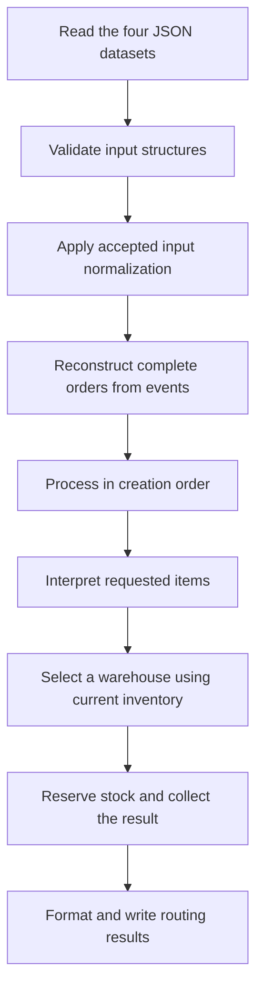

# Project structure and architecture

## Context and current scope

Rafael selected this structure while exploring the application's responsibilities and data flow. The application will use TypeScript 6 and Bun, with pnpm managing dependencies, Zod checking incoming data structures, and Vitest providing the test runner.

The current work establishes the project shape and development tooling. All application and test files in `src/` are empty. `tests/` contains an empty `.gitkeep` to retain the directory in Git. `routes.txt` is an empty output placeholder, not a generated routing result. The following responsibilities describe the intended implementation.

ZIP handling, SKU matching, and bundle stock handling remain [open questions](../ASSUMPTIONS.md#open-questions). Creating modules for these concerns does not adopt a policy or authorize their implementation.

## Project structure

```text
raicom/
├── data/
│   ├── catalog.json
│   ├── orders.json
│   ├── warehouses.json
│   └── zones.json
├── src/
│   ├── router.ts
│   ├── application/
│   │   └── route-orders.ts
│   ├── domain/
│   │   ├── order.ts
│   │   ├── order.test.ts
│   │   ├── catalog.ts
│   │   ├── catalog.test.ts
│   │   ├── warehouse.ts
│   │   ├── warehouse.test.ts
│   │   ├── routing.ts
│   │   └── routing.test.ts
│   ├── repositories/
│   │   ├── orders.repository.ts
│   │   ├── catalog.repository.ts
│   │   ├── warehouses.repository.ts
│   │   ├── zones.repository.ts
│   │   └── routes.repository.ts
│   ├── schemas/
│   │   ├── order.schema.ts
│   │   ├── catalog.schema.ts
│   │   ├── warehouse.schema.ts
│   │   └── zones.schema.ts
│   └── normalization/
│       ├── zip.ts
│       ├── zip.test.ts
│       ├── sku.ts
│       └── sku.test.ts
├── tests/
│   └── .gitkeep
├── docs/
│   ├── ARCHTECTURE.md
│   └── data-research.md
├── .gitignore
├── AGENTS.md
├── package.json
├── pnpm-lock.yaml
├── tsconfig.json
├── routes.txt
├── JOURNAL.md
├── DECISIONS.md
└── ASSUMPTIONS.md
```

This tree focuses on the application and supporting documents. The supplied originals remain in `raicom-files/`, and project-scoped skills remain in `.agents/skills/`.

## Responsibilities

| Folder or file | Responsibility |
|---|---|
| `data/` | Unmodified working copies of the supplied JSON datasets, ready for ingestion. |
| `src/router.ts` | Executable entry point: establish file locations, invoke the application workflow, and report its outcome. |
| `src/application/route-orders.ts` | Coordinate input loading, complete-order reconstruction, item interpretation, sequential routing with inventory state, and output writing. |
| `src/domain/` | Internal types and business rules for orders, catalog items, warehouses, inventory, and routing results. |
| `src/repositories/` | File access. Input repositories coordinate reading, schema validation, and any accepted normalization. The routes repository formats and writes results. |
| `src/schemas/` | Zod schemas for the shapes and types of incoming data. Runtime checks complement TypeScript's static types. |
| `src/normalization/` | Functions for accepted transformations of input representations. ZIP and SKU policies remain deferred. |
| Adjacent `*.test.ts` files | Focused unit tests for the modules beside them. These files currently contain no tests. |
| `tests/` | Integration tests covering collaboration between modules and the complete output, once implemented. |
| `routes.txt` | Eventual textual routing output, with one line per order. Currently empty. |

Use small modules and plain functions. The folder boundaries do not require a class, interface, or dependency-injection framework for each responsibility.

## Data flow



The interpretation, selection, and reservation steps run sequentially for each order. Later orders see inventory after earlier reservations. The diagram does not specify the deferred normalization or bundle policies.

### Input loading

Repositories receive the dataset locations, read the files, parse JSON, and use schemas to check their structure. They can call normalization functions once the relevant policies are accepted. Schemas describe incoming representations; domain types describe the concepts used by later processing.

Loading preserves the evidence needed for unresolved policies. A numeric ZIP, an SKU with different casing, and a bundle line must not be silently repaired or reinterpreted while those policies remain open. Missing or empty ZIPs must remain representable for later order-level handling. File failures and structural diagnostics should identify their source; the exact failure-handling policy remains to be designed.

The orders repository reads events. It does not hide complete-order reconstruction inside file access. The zones schema distinguishes warehouse maps from metadata such as `_note`.

### Order reconstruction and domain rules

The application coordinates reconstruction of complete orders, with order-related rules in `domain/order.ts`. Creation and edit events are connected through their order identifier, and the resulting orders retain creation order.

Catalog composition rules belong in `domain/catalog.ts`; the application coordinates their use. This allocation identifies where bundle handling belongs while leaving its behavior open. Warehouse availability and inventory reservation belong in `domain/warehouse.ts`. Candidate evaluation and ranking belong in `domain/routing.ts`.

### Selection, reservation, and output

Selection reads the order and current inventory without reducing stock while evaluating candidates. Reservation applies inventory changes after selection. The application carries the updated inventory through the remaining orders.

Routing returns structured results. The routes repository converts them into the required textual representation and writes `routes.txt`. Business decisions remain independent of filesystem operations and output formatting.

## Tooling

Dependencies are recorded in [package.json](../package.json) and resolved versions in [pnpm-lock.yaml](../pnpm-lock.yaml). pnpm is pinned to 10.11.0. TypeScript remains on major version 6. Zod is a runtime dependency; TypeScript, Vitest, and Bun type definitions are development dependencies.

| Command | Purpose at this stage |
|---|---|
| `pnpm install --frozen-lockfile` | Install the dependency versions recorded in the lockfile. |
| `pnpm start` | Invoke the empty entry point using Bun. It does not produce routing results yet. |
| `pnpm typecheck` | Run TypeScript's no-emit check using Bun and the project configuration. |
| `pnpm test` | Invoke Vitest once without watch mode. The empty test placeholders are not a passing test suite. |

Node must be available for pnpm and Vitest tooling. Bun runs the application and the TypeScript compiler command. The installed Bun version is 1.3.14; the available Node tooling version is 22.15.0.

A temporary Vitest runner check passed under Node 22.15.0. Direct Vitest runs under Bun 1.3.14 timed out, so the configured test command uses Node. This checks the runner only; the project's test files remain empty and application behavior has not been tested.

The [Bun runtime documentation](https://bun.sh/docs/runtime) describes direct TypeScript execution. [Vitest's requirements](https://vitest.dev/guide/#adding-vitest-to-your-project) specify its Node tooling requirements. Use the configured test script for Vitest; `bun test` invokes Bun's separate test runner.

## Related project knowledge

- [Data research](data-research.md): observed input shapes, counts, relationships, and data-quality findings.
- [Assumptions](../ASSUMPTIONS.md): adopted behavioral interpretations and separate open questions.
- [Decisions](../DECISIONS.md): accepted engineering choices and their rationale.
- [Journal](../JOURNAL.md): chronology, collaboration, and verification.
