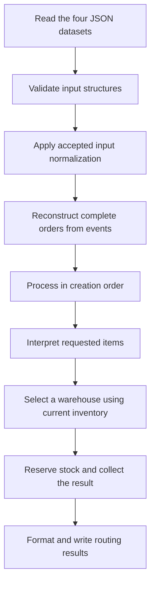

# Project structure and architecture

## Context and current scope

Rafael selected this structure while exploring the application's responsibilities and data flow. The application will use TypeScript 6 and Bun, with pnpm managing dependencies, Zod checking incoming data structures, and Vitest providing the test runner.

The catalog, order-event, warehouse, zone, SKU, and postal contracts are implemented with adjacent unit tests. The raw JSON loader lives in `src/lib/loader/`; pure normalization helpers live in `src/normalization/`. Parameterless repositories return parsed output to the domain, which creates a fresh routing context. The argument-free coordinator uses only domain functions to reconstruct, expand bundles, select, reserve, and publish routes. Synthetic scenarios and the real `pnpm start` path pass against independent expected output. `routes.txt` contains the verified 26-order output for the supplied datasets. General unknown-SKU behavior remains explicitly unimplemented.

Rafael selected [case-insensitive SKUs and uppercase normalization](../ASSUMPTIONS.md#canonical-uppercase-sku-identifiers), implemented through the shared SKU contract. The [separate postal assessment](../DECISIONS.md#separate-postal-assessment-from-source-zip) applies to exact `"US"` destinations without ZIP trimming. [Bundle stock interpretation](../ASSUMPTIONS.md#bundle-stock-from-standalone-components) is now adopted and implemented; remaining SKU questions stay [open](../ASSUMPTIONS.md#open-questions).

Every parsed destination now has string `shipTo.zip`: recognized US ZIPs use their normalized value; missing values become empty text; unrecognized and outside-US values become text without postal repair. Assessment contains no duplicated value. Source JSON, original input objects, and loader cache remain unchanged.

Rafael accepted Zod runtime input contracts with explicit inferred TypeScript input/output types and small reusable sub-contracts. The catalog rules below use bounded, field-specific acceptance. SKU conversion and country-aware postal assessment run through schema transformations; see [schema patterns](schemas.md) for the maintained coding guidance.

## Project structure

```text
raicom/
├── data/
│   ├── catalog.json
│   ├── orders.json
│   ├── warehouses.json
│   └── zones.json
├── src/
│   ├── router.ts
│   ├── lib/
│   │   └── loader/
│   │       ├── Loader.ts
│   │       └── Loader.test.ts
│   ├── application/
│   │   ├── route-orders.ts
│   │   └── route-orders.test.ts
│   ├── domain/
│   │   ├── order.ts
│   │   ├── order.test.ts
│   │   ├── catalog.ts
│   │   ├── catalog.test.ts
│   │   ├── warehouse.ts
│   │   ├── warehouse.test.ts
│   │   ├── routing.ts
│   │   ├── routing-context.test.ts
│   │   └── routing.test.ts
│   ├── repositories/
│   │   ├── orders.repository.ts
│   │   ├── catalog.repository.ts
│   │   ├── warehouses.repository.ts
│   │   ├── zones.repository.ts
│   │   ├── routes.repository.ts
│   │   ├── routes.repository.test.ts
│   │   └── ingestion.test.ts
│   ├── schemas/
│   │   ├── order.schema.ts
│   │   ├── order.schema.test.ts
│   │   ├── catalog.schema.ts
│   │   ├── catalog.schema.test.ts
│   │   ├── sku.schema.ts
│   │   ├── sku.schema.test.ts
│   │   ├── zip.schema.ts
│   │   ├── zip.schema.test.ts
│   │   ├── warehouse.schema.ts
│   │   ├── warehouse.schema.test.ts
│   │   ├── zones.schema.ts
│   │   └── zones.schema.test.ts
│   └── normalization/
│       ├── zip.ts
│       ├── zip.test.ts
│       ├── sku.ts
│       └── sku.test.ts
├── tests/
│   ├── .gitkeep
│   ├── route-orders.integration.test.ts
│   ├── bundle-routing.integration.test.ts
│   ├── assessment.integration.test.ts
│   ├── router.cli.test.ts
│   └── fixtures/
│       ├── cli-routing/          # Original standalone synthetic scenario
│       │   ├── README.md
│       │   ├── expected.txt
│       │   └── fixtures.ts
│       └── assessment/           # Independent supplied-data oracle and ledger
│           ├── README.md
│           └── expected.txt
├── docs/
│   ├── ARCHTECTURE.md
│   ├── data-research.md
│   └── schemas.md
├── .gitignore
├── AGENTS.md
├── package.json
├── pnpm-lock.yaml
├── tsconfig.json
├── routes.txt
├── JOURNAL.md
├── DECISIONS.md
└── ASSUMPTIONS.md
```

This tree focuses on the application and supporting documents. The supplied originals remain in `raicom-files/`, and project-scoped skills remain in `.agents/skills/`.

## Responsibilities

| Folder or file | Responsibility |
|---|---|
| `data/` | Unmodified working copies of the supplied JSON datasets, ready for ingestion. |
| `src/lib/loader/` | Shared raw JSON reading, guarded parsing, lazy caching, and independent copies for callers. Returns `unknown` without Zod validation or normalization. |
| `src/router.ts` | Bun entry point: invoke `routeOrders()` and report execution failures to stderr with a nonzero exit. It contains no source paths. |
| `src/application/route-orders.ts` | Compose domain functions to reconstruct and sort orders, visibly apply rules 1–7, reserve before the next order, and publish results. No arguments, repository imports, or source configuration. |
| `src/domain/` | Obtain repository data and create a run-local context; evaluate reconstruction, product, selection, and reservation rules. Publication delegates to the output repository. |
| `src/repositories/` | Parameterless input functions call the respective existing loaders, parse once with Zod, and return normalized objects. The routes repository formats structured results and prints stdout. |
| `src/schemas/` | Zod schemas for incoming data and canonical output. Compose SKU conversion and country-aware postal assessment at this boundary. |
| `src/normalization/` | Pure SKU conversion and US ZIP assessment without runtime Zod imports, country/state logic, lookups, or file access. |
| Adjacent `*.test.ts` files | Focused tests for contracts, loaders, normalization, repository boundaries, domain behavior, and application sequencing. |
| `tests/` | Synthetic application integration with only loaders mocked, plus real-file application/final-stock verification and a real `pnpm start` subprocess test. Expected results are independently established. |
| `routes.txt` | Captured CLI output for all 26 supplied orders; checked byte-for-byte against the independent expected output. |

Use small modules and plain functions. The folder boundaries do not require a class, interface, or dependency-injection framework for each responsibility.

### Incremental Part A development

Rafael corrected the initial skeleton's ownership of sources and directed implementation in seven sequential deliverables. The dependency flow is **CLI → application → domain → repositories → loaders and schemas**. The coordinator reconstructs orders with eligible additions, sorts by creation time, then performs sequential selection and reservation. Country and postal checks return early for each order. Ranking preserves empty lists and priority returns `undefined` for an empty list, reaching rule 7.

`routeOrders(): Promise<RoutingResult[]>` imports only domain functions and types. `prepareRoutingRun()` obtains parsed events, catalog, zones, and warehouses through parameterless repositories and returns `RoutingContext`; it retains no mutable state between runs. Source URLs remain in the existing loader configuration. Rules consume the parsed context, and the coordinator assigns the new `reserveStock` inventory before advancing. `publishRoutes()` delegates output to the routes repository. No service classes or dependency-injection framework are required.

Run `pnpm test tests` for the application and CLI scenarios. The [original synthetic fixture](../tests/fixtures/cli-routing/README.md) and [supplied-data ledger](../tests/fixtures/assessment/README.md) record independent calculations; never regenerate expected results from application output. Synthetic tests substitute raw TypeScript objects only at the loader boundary. `assessment.integration.test.ts` uses real files and checks final stock/cache preservation; `router.cli.test.ts` invokes `pnpm --silent start`, checking exact output and empty stderr. No temporary project, environment override, or source argument is needed.

Bundle expansion was implemented from failing domain and integration tests after Rafael adopted the policy. All 26 supplied orders now route successfully. General unknown-SKU behavior still throws a named `not implemented` error; nested bundles and unknown component references produce explicit unsupported-component errors. Duplicate creation and unmatched-edit reconciliation also remain explicitly unsupported. These cases are absent from the supplied dataset and do not acquire invented routing policies.

## Data flow



The interpretation, selection, and reservation steps run sequentially for each order. Later orders see inventory after earlier reservations. Bundle interpretation expands component quantities before stock eligibility without changing zone precedence.

The diagram separates validation and normalization conceptually. Composed Zod contracts perform SKU conversion and country-aware postal assessment. Neither transformation implements order reconstruction, zone lookup, or bundle rules.

### SKU normalization design status

The implemented boundary composes a pure uppercase function with a nonblank uppercase canonical SKU contract, exposing `z.input` and `z.output` types. Its [engineering decision](../DECISIONS.md#sku-transformation-at-the-input-boundary) accepts branded output and omits collision refinements under the [supplied-data assumption](../ASSUMPTIONS.md#no-distinct-sku-collisions-after-normalization). Whitespace remains unchanged; complete identifier grammar and unknown-SKU behavior remain open. See [schema patterns](schemas.md) before extending these contracts.

### Postal assessment design status

The implemented `ShipToSchema` preserves original input objects and returns a separate destination with required string `zip` and `postalAssessment`. Only `country === "US"` invokes the US helper on the raw ZIP type before text conversion. Other destinations use pure text conversion and receive null assessment without US repair. The domain's international routing check applies before postal coverage; there is no international assessment branch.

The [implemented output revision](../DECISIONS.md#separate-postal-assessment-from-source-zip) stores the normalized recognized string directly in output `zip`, with assessment containing only kind and prefix. Missing/null/omitted values become `""`; other unrecognized or outside-US values become text without additional postal repair. Numeric `2134` and string `"2134"` retain different US recognition outcomes. These transformations do not change the raw recognition rules.

Recognized ZIPs retain the full supported five-digit or ZIP+4 string, validated through the canonical scalar contract, and assessment carries a matching branded prefix. Destination output ZIP is statically string across all branches. The [recognition policy](../ASSUMPTIONS.md#zip-recognition-and-repair-by-raw-type) rejects padded/whitespace-only strings without trimming. State is preserved without ZIP inference or cross-checking; country is not normalized. US country context does not establish ZIP correctness. Zone lookup, warehouse eligibility/ranking, and PARTNER selection remain outside assessment. The raw ZIP contract still preserves source representations; derived fields and normalized strings are never written into input objects, raw JSON, or loader cache.

### Input loading

Repositories coordinate raw loading and schema validation. Each parameterless input repository calls its respective loader, receives `unknown`, applies its composed schema, and returns typed parsed output. Domain initialization calls the repositories once per run. Schema outputs are consumed rather than reparsed as raw input.

Raw loading preserves source values, including numeric ZIPs, SKU casing, and bundle lines. Schema parsing produces normalized SKU and ZIP strings while leaving source data untouched and preserving bundle quantities. Missing ZIP becomes empty output text and an appropriate US assessment or outside-US null. Loading and validation errors propagate to the CLI, which reports the error message and exits nonzero; they never become empty datasets or PARTNER decisions.

The orders repository reads events. It does not hide complete-order reconstruction inside file access. The zones schema distinguishes warehouse maps from metadata such as `_note`.

### Order reconstruction and domain rules

The application coordinates reconstruction using `domain/order.ts`. A two-pass reconstruction connects events by order number independently of arrival order, includes additions from creation through 30 minutes inclusive, and returns copied order data. A separate function sorts by creation timestamp without mutating the input list. Both operations preserve all fractional-second digits accepted by the schema: timezone-adjusted whole seconds and zero-padded decimal fractions are compared separately, avoiding `Date.parse`'s millisecond truncation without narrowing input acceptance.

`domain/catalog.ts` resolves standalone products and one-level bundles. Bundle count multiplies each component quantity, and direct/bundle/eligible-edit demand is aggregated by canonical product SKU. Only standalone catalog products can be components; expansion never recursively follows bundle references. Original order lines remain unchanged. `domain/routing.ts` evaluates stock eligibility and ranking; `domain/warehouse.ts` applies reservation. All three consume the same aggregated demand, not uncombined event lines. No splitting, bundle-specific stock, or bundle-specific velocity is introduced.

### Selection, reservation, and output

Selection reads current inventory without reducing stock. Zone takes precedence over cover; cover is the minimum pre-reservation `available / dailyVelocity` across requested products. Positive available stock with zero velocity has infinite cover, and direct equality preserves infinite ties. Remaining ties use WH-NJ, WH-GA, WH-NV, WH-TX. Reservation returns a copied inventory state after checking the selected warehouse can fulfill every product. PARTNER routes reserve no internal stock.

Routing returns structured results. Domain publication passes them to the routes repository, which prints one tab-separated stdout line per order: number, warehouse or PARTNER, then `zone=N` or fallback reason. Empty results print nothing. The repository does not automatically write `routes.txt`; the workspace artifact was captured with `pnpm --silent start > routes.txt` and verified against the independent oracle. Business decisions remain independent of output formatting.

Publication awaits the stdout write callback rather than the boolean returned by `write`. Callback failures and stream error events reject through the existing domain/application/CLI error path. A temporary listener remains through the current turn after a callback failure because Node can emit a subsequent error event while Bun can report the failure only through the callback; cleanup removes only that listener. Tests exercise delayed completion, asynchronous writable failure, and a real closed stdout pipe.

## Catalog input contract exploration

### Purpose and status

Rafael chose to explore the catalog first to understand the effort and value of TypeScript types and Zod runtime contracts before implementing data loading. He accepted Zod with inferred input types, followed by reusable composition and the catalog rules below. The examples retain the earlier comparison; the implemented contracts linked in the catalog section are the current source of truth.

The observed catalog contains three product records and one bundle record. Both kinds have `sku`, `name`, and `priceCents`; bundles additionally contain component records with `sku` and `quantity`. These input records are distinct from any internal domain model we may introduce later. See [data research](data-research.md) for the full observations.

### TypeScript type declarations

```ts
type ProductInput = {
  sku: string;
  name: string;
  priceCents: number;
};

type ComponentInput = {
  sku: string;
  quantity: number;
};

type BundleInput = ProductInput & {
  components: ComponentInput[];
};

type CatalogInput = {
  products: ProductInput[];
  bundles: BundleInput[];
};
```

These declarations describe the shape used during development. For example, TypeScript can reject a typed object literal whose `priceCents` is a string. An interface can describe these object shapes too; the type/interface choice does not add runtime checks.

```ts
const catalog = JSON.parse(text) as CatalogInput;
```

This assertion tells the compiler to trust the programmer. It does not inspect the parsed value, so a file containing a string price or a missing `products` array can pass through this line. Type assertions are erased and perform no runtime checking. [TypeScript documentation](https://www.typescriptlang.org/docs/handbook/2/everyday-types.html#type-assertions)

We could instead read the parsed value as `unknown` and write explicit runtime checks. That is a viable dependency-free option, but the checks, type declarations, and diagnostics must be kept consistent manually.

### Zod schema with an inferred TypeScript type

```ts
import { z } from "zod";

const ProductSchema = z.object({
  sku: z.string(),
  name: z.string(),
  priceCents: z.number(),
});

const ComponentSchema = z.object({
  sku: z.string(),
  quantity: z.number(),
});

const BundleSchema = ProductSchema.extend({
  components: z.array(ComponentSchema),
});

const CatalogSchema = z.object({
  products: z.array(ProductSchema),
  bundles: z.array(BundleSchema),
});

type CatalogInput = z.infer<typeof CatalogSchema>;
```

This alternative defines the shape once as an executable schema and infers its TypeScript representation. It does not require maintaining the preceding hand-written input types as well. Zod provides `.parse()` to return parsed data or throw validation issues, and `.safeParse()` to return a success/error result. Choosing how the application responds to an error remains separate. [Zod basic usage](https://zod.dev/basics)

For example, the schema rejects `priceCents: "2995"` rather than converting it to a number, and can identify the failing field within a product array. It verifies the component record shape without interpreting how a bundle affects inventory.

The sample deliberately shows only basic field types and arrays. It does not establish integer or positivity rules, nonempty arrays or strings, SKU uniqueness, or component-reference validity. Those are additional constraints to evaluate, rather than guarantees obtained automatically from this shape.

There is also an object-key behavior to choose: ordinary `z.object` schemas strip unrecognized properties from their parsed output. Zod offers `z.strictObject` to reject them and `z.looseObject` to retain them. Therefore, the illustrative schema must not be treated as an accepted preserve/strip/reject policy. No SKU transformations, coercion, or inventory operations are proposed here. [Zod object schemas](https://zod.dev/api#objects)

### Complexity and trade-offs

| Approach | Static typing | Runtime input checking | Maintenance cost |
|---|---|---|---|
| Hand-written types with trusted JSON | Yes | None from the types | Short declarations; malformed input remains unchecked. |
| Hand-written types and runtime checks | Yes | Whatever the checks explicitly cover | No validation dependency; checks and diagnostics must stay aligned with the types. |
| Zod schemas and inferred input types | Yes | Whatever the schemas explicitly cover | Four small reusable schema definitions, a parsing call, and error handling; the schema owns the input type. |

For this catalog, the schema structure is shallow and closely follows the supplied JSON. Rafael accepted Codex's recommendation to keep Zod at the input boundary and infer the input types, avoiding a duplicate hand-written input contract. The cost is learning the schema API and selecting acceptance and error-handling behavior. No performance benchmark has been made.

If an internal domain model later differs from these records, it can have its own type and mapping. Schema inference need not dictate the entire domain design.

The catalog repository uses the guarded loader, parses the contract, and returns typed output records to domain initialization. Errors propagate to the entry point. Order reconstruction, bundle stock interpretation, and routing remain domain concerns outside the catalog schema.

### Accepted principle: bounded permissiveness

Rafael wants contracts to reflect reasonable field representations, including explicit alternatives where the data mixes strings and numbers, without accepting arbitrary types or meaningless values. This is a field-specific principle, not permission to add a string/number union everywhere or to coerce values automatically.

The catalog itself currently has consistent types: SKUs and names are strings, while prices and component quantities are numbers. No mixed-type field was found here. The initial model therefore needs no string/number unions. A later change to accept numeric strings would require a reason beyond a variation observed in a different dataset.

Plausibility also depends on the field. A standalone scalar cannot represent the catalog object; a letter cannot represent a numeric price. Conversely, the number `1` is a supplied and meaningful component quantity. A blanket ban on one-digit values or a minimum string length inferred from sample lengths would not follow the field's meaning.

### Catalog contract

Rafael accepted the model and asked to proceed with this dataset using reusable sub-contracts. The implementation is in [catalog.schema.ts](../src/schemas/catalog.schema.ts), with [sku.schema.ts](../src/schemas/sku.schema.ts) shared across product, bundle, and component records. Local name, price, and quantity sub-contracts complete the composition. Exported input and output types use `z.input` and `z.output` respectively.

| Location | Accepted shape | Constraints |
|---|---|---|
| Catalog root | Object with `products` and `bundles` arrays | Both arrays required; reject unknown object fields. Do not require exactly three products or one bundle. |
| Product | Object with `sku`, `name`, and `priceCents` | All fields required; reject unknown object fields. |
| Bundle | Product-shaped fields plus a `components` array | All fields required; at least one component; reject unknown object fields. |
| Component | Object with `sku` and `quantity` | Both fields required; reject unknown object fields. |
| Any `sku` | String input; branded `Sku` output | Reject empty or whitespace-only text; uppercase while preserving whitespace. No project-specific identifier grammar has been selected. |
| Any `name` | String | Reject empty or whitespace-only text; retain original text. No arbitrary minimum name length. |
| `priceCents` | Number | Integer, zero or greater. Numeric strings, fractions, negatives, null, and booleans are rejected. Allowing a zero price is an adopted constraint, not a finding from the sample. |
| `quantity` | Number | Positive integer. A quantity of `1` is valid; numeric strings, fractions, zero, negatives, null, and booleans are rejected. |

The root product and bundle arrays may be empty; no minimum catalog size is inferred from the sample. The contract rejects unknown keys and enforces the accepted value bounds and nonempty bundle components. SKU case conversion is explicit; no numeric coercion, trimming, or bundle expansion is introduced.

Nonblank uppercase text alone does not prove that an SKU is meaningful. A value such as `A` still satisfies that basic constraint. Rejecting it requires an agreed identifier grammar or another explicit identifier rule; neither has been invented from the sample. SKU uniqueness and component-reference checks remain separate from the basic record shape. Case-insensitive comparison is accepted; the catalog domain resolver checks that expanded components reference standalone products.

Focused tests cover the supplied catalog, malformed structures, unknown keys at every object level, numeric bounds and types, nonblank text, SKU conversion, and unchanged source objects and unrelated values. They do not establish inventory or routing behavior.

## Warehouse input contract

Rafael requested warehouse and zone schemas one per turn. [warehouse.schema.ts](../src/schemas/warehouse.schema.ts) was implemented first; the zone contract followed separately. Warehouse records compose `WarehouseCodeSchema`, a nonblank city contract, and `InventoryEntrySchema`. The file exports `WarehouseSchema` for one record and `WarehousesSchema` for the dataset array, with inferred input types.

| Field or structure | Implemented contract |
|---|---|
| Root | Array of warehouse records; no fixed count or nonempty requirement. |
| Warehouse | Strict object requiring `code`, `city`, `enabled`, and `inventory`. |
| `code`, `city` | Nonblank strings, preserving supplied text and casing. No code grammar or whitelist of the four current codes. |
| `enabled` | Boolean; false is accepted and preserved. No string or numeric coercion. |
| `inventory` | Record with keys validated by the shared `SkuSchema` and values validated by `InventoryEntrySchema`. An empty inventory is representable. |
| Inventory entry | Strict object requiring `available` and `dailyVelocity`. |
| `available` | Nonnegative integer number; zero stock is valid. |
| `dailyVelocity` | Nonnegative finite number; zero is valid. Fractional values are accepted because the field represents a rate. |

Fractional velocity is an implementation interpretation of a rate, not a variation observed in the supplied file, whose velocities are integers. Zero velocity is directly present in the supplied data. The contract accepts it without defining days-of-cover division or ranking behavior.

Strictness applies to the fixed warehouse and inventory-entry fields; inventory SKU names are dynamic and use the shared SKU transformation. The schema uppercases keys without collision checks under the accepted assessment assumption. It does not check catalog membership, require every catalog product, or enforce unique warehouse codes.

The schema implementation does not alter warehouse enablement, compute cover, reserve inventory, or load files. The [warehouse tests](../src/schemas/warehouse.schema.test.ts) check the supplied data, strict fields, malformed types and keys, numeric boundaries, and preservation of accepted values.

## Zones input contract

[zones.schema.ts](../src/schemas/zones.schema.ts) composes ZIP-prefix, zone-value, and warehouse-map contracts. Warehouse keys reuse `WarehouseCodeSchema` from the warehouse module. All exported input types are inferred from the schemas.

| Field or structure | Implemented contract |
|---|---|
| Root | Object with required string `_note` metadata and dynamic warehouse-map entries. |
| Warehouse key | Nonblank string; no fixed whitelist or count. `_note` is reserved for metadata. |
| Warehouse map | Record from ZIP-prefix strings to zone numbers. Empty maps are representable; no fixed count or coverage requirement. |
| ZIP-prefix key | Exactly three ASCII digits, preserving leading zeros. No padding, trimming, or extraction from a full ZIP. |
| Zone value | Integer number from 1 through 8, as described by the supplied metadata. No string coercion. |

The raw root combines a string with dictionary values. The schema declares `_note`, validates additional entries through a catchall, and refines those entries so strings cannot masquerade as warehouse maps and warehouse codes cannot be blank. The parsed output retains the original layout. Its dynamic value type includes the metadata string, so consumers must distinguish metadata from warehouse maps.

No extra metadata names are accepted as strings. Other nonblank keys can represent warehouse maps; matching those codes to the warehouse dataset and checking prefix coverage across maps are separate cross-file concerns. An object containing only `_note` is structurally representable, consistent with allowing empty dataset collections.

The prefix contract is shared with postal assessment through [zip.schema.ts](../src/schemas/zip.schema.ts) and re-exported from the zones module for compatibility. Lookup keys remain exact three-digit strings without repair; their output types are now branded. The [zone tests](../src/schemas/zones.schema.test.ts) cover the supplied table, preserved metadata and keys, malformed maps, invalid prefixes, and zone bounds. File loading and routing remain outside this contract.

## Order-event input contract

Rafael clarified that `orders.json` contains events, not final `Order` entities. [order.schema.ts](../src/schemas/order.schema.ts) keeps the planned filename but exports event-specific contracts and inferred input types. `OrderEventSchema` is a discriminated union keyed by `type`; `OrderEventsSchema` represents the dataset array.

| Event variant | Required fields |
|---|---|
| `order_created` | `type`, `orderNumber`, `at`, `shipTo`, and a nonempty `lines` array. |
| `order_edited` | `type`, `orderNumber`, `at`, and a nonempty `addedLines` array. |

Both variants compose a shared event base. Order lines share the reusable `SkuSchema` and require positive integer numeric quantities. Creation destinations use a strict `ShipToSchema`; lines and event variants are strict objects too. Unknown fields and mixtures of the two event shapes are rejected.

| Shared field or structure | Implemented contract |
|---|---|
| `orderNumber` | Nonblank string, preserved without a fixed number grammar. |
| `at` | ISO datetime string with an explicit timezone (`Z` or an offset), preserved as a string. Invalid dates and timezone-free values are rejected. |
| `shipTo.country`, `shipTo.state` | Required nonblank strings. No hardcoded country/state whitelist or case normalization. |
| Input `shipTo.zip` | Raw string or finite number; an absent field or null is also representable. Recognition uses this raw type. |
| Output `shipTo.zip` | Required string. Recognized US ZIP is normalized, missing becomes `""`, and other values become text without postal repair. |
| Output `shipTo.postalAssessment` | Strict recognized/missing/unrecognized assessment for exact `"US"`, or null otherwise. Recognized assessment contains only kind and branded prefix, checked against output ZIP. Source-supplied derived fields are rejected. |
| Line `sku` | Shared contract uppercases nonblank strings and brands the output; no membership checks or bundle expansion. |
| Line `quantity` | Positive integer number; no numeric-string coercion. |
| Root | Array of events, including an empty array; no fixed event count. |

The raw ZIP contract preserves source representations, including numeric `2134`, empty strings, ZIP+4, and international postal codes. Null is additionally allowed as absent input, not an observed example from this file. The parsed output always supplies a string ZIP and a country-aware assessment under the [accepted policy](../ASSUMPTIONS.md#zip-recognition-and-repair-by-raw-type). Structural errors reject unsupported raw types before output conversion; supported unusable US representations remain available for later fallback. Neither recognition nor structural acceptance proves postal validity. Strict output object checks preserve raw unknown-field diagnostics; see the [schema guide](schemas.md#country-aware-postal-assessment) before changing the pipeline.

Parsing does not reconstruct orders, combine lines, sort events, check uniqueness or creation/edit relationships, or enforce the edit window. Those concerns belong to later processing. Inferred event types allow application code to distinguish creation from edit fields using `type`, while keeping the reconstructed order concept separate.

The [order-event tests](../src/schemas/order.schema.test.ts) check the complete supplied event stream, supported variants, malformed or hybrid shapes, raw-value preservation, timestamps, missing ZIP representation, and item quantities. Loading, reconstruction, and routing are tested separately in their respective layers.

## Shared raw JSON loading

[Loader.ts](../src/lib/loader/Loader.ts) exports `parseJson`, `createJsonLoader`, and one loader for each dataset. Each loader lazily reads its file, shares an in-flight request, caches a successful parsed value, and retries after read or parse failures. Every call receives a structured clone to prevent caller mutations from changing the cached raw input. The module invokes neither Zod schemas nor normalization.

The four dataset URLs use `../../../data/<filename>.json` relative to `import.meta.url`. They therefore resolve from `src/lib/loader/` to the project datasets independently of the process working directory. The [adjacent tests](../src/lib/loader/Loader.test.ts) import the schemas through `../../schemas/` and check the four real dataset paths as well as guarded parsing and cache behavior.

Both files now match `src/**/*.ts` in the existing `tsconfig.json` and receive its Bun type declarations. Before relocation, `data/Loader.ts` and its test were outside project typechecking. Isolated compilation without runtime declarations reproduced TS2591 at `node:fs/promises`; compilation with Bun types succeeded. After relocation, the normal project typecheck includes both files and passes without changing the import, dependencies, or TypeScript configuration. The editor UI itself was not inspected.

## Guarded JSON ingestion

For application ingestion, pass JSON text through the existing `parseJson` helper or a dataset loader before using either `.parse()` or `.safeParse()` on a Zod contract. For example:

```ts
const rawZones = await loadZones();
const result = ZonesSchema.safeParse(rawZones);
```

The parser rejects `__proto__`, `constructor`, and `prototype` as object property names at any depth, including names decoded from JSON escapes. Rafael accepted this broader key restriction. It applies to dictionary keys such as inventory SKU keys; it does not reject those words inside string values or impose a SKU value grammar. Existing unit tests that use `JSON.parse` to isolate a schema are not demonstrations of guarded application ingestion.

The issue is bypassing the guarded ingestion boundary, not the syntactic nesting of calls. Using `JSON.parse` first and passing the resulting value to `.parse()` or `.safeParse()` later also skips the guard. No additional schema-level protections are being implemented for this known limitation.

## Known review limitations

The independent schema review found that the installed Zod version silently drops an own JSON `__proto__` key while parsing dynamic records and catchalls. For example, an inventory dictionary containing `"__proto__": "invalid inventory entry"` can succeed and return an empty inventory; the same omission affects warehouse zone maps and the zones root. This bypasses validation of that entry and breaks the intended preservation guarantee. The supplied datasets contain no such keys.

The main agent independently reproduced the finding and accepted it as low-priority P3 hardening, reducing the reviewer's P2 rating because the fixed assessment inputs are unaffected. The shared loader now rejects the reserved keys before schema parsing, mitigating the issue for callers that use it. Direct schema calls on values parsed elsewhere can still exhibit the original behavior. Rafael explicitly accepted documenting this coverage limit and moving forward without additional guards or a change to Zod contracts.

## Tooling

Dependencies are recorded in [package.json](../package.json) and resolved versions in [pnpm-lock.yaml](../pnpm-lock.yaml). pnpm is pinned to 10.11.0. TypeScript remains on major version 6. Zod is a runtime dependency; TypeScript, Vitest, and Bun type definitions are development dependencies.

| Command | Purpose at this stage |
|---|---|
| `pnpm install --frozen-lockfile` | Install the dependency versions recorded in the lockfile. |
| `pnpm start` | Invoke `routeOrders()` through Bun and print all 26 supplied orders. |
| `pnpm --silent start > routes.txt` | Capture route lines without pnpm's script banner. |
| `pnpm typecheck` | Run TypeScript's no-emit check using Bun and the project configuration. |
| `pnpm test src/schemas` | Run the implemented catalog, order-event, warehouse, zone, and SKU contract tests. |
| `pnpm test src/schemas src/lib/loader` | Run all implemented input-contract and loader tests. |
| `pnpm test src/schemas src/lib/loader src/normalization` | Run all implemented input-contract, loader, and SKU/ZIP normalization tests. |
| `pnpm test tests/route-orders.integration.test.ts` | Run the supported synthetic scenario through real application layers with only loaders mocked. |
| `pnpm test tests` | Run standalone/bundle scenarios, real-file final-stock verification, and the real CLI acceptance test. |
| `pnpm test` | Run all unit and application integration suites; there are no empty domain test placeholders. |

Node must be available for pnpm and Vitest tooling. Bun runs the application and the TypeScript compiler command. The installed Bun version is 1.3.14; the available Node tooling version is 22.15.0.

A temporary Vitest runner check passed under Node 22.15.0. Direct Vitest runs under Bun 1.3.14 timed out, so the configured test command uses Node. The full suite and typechecking now pass with this tooling, including application coordination and the supported routing scenario.

The [Bun runtime documentation](https://bun.sh/docs/runtime) describes direct TypeScript execution. [Vitest's requirements](https://vitest.dev/guide/#adding-vitest-to-your-project) specify its Node tooling requirements. Use the configured test script for Vitest; `bun test` invokes Bun's separate test runner.

## Related project knowledge

- [Data research](data-research.md): observed input shapes, counts, relationships, and data-quality findings.
- [Schema patterns](schemas.md): maintained guidance for Zod composition, transformations, inferred types, and guarded ingestion.
- [Assumptions](../ASSUMPTIONS.md): adopted behavioral interpretations and separate open questions.
- [Decisions](../DECISIONS.md): accepted engineering choices and their rationale.
- [Journal](../JOURNAL.md): chronology, collaboration, and verification.
